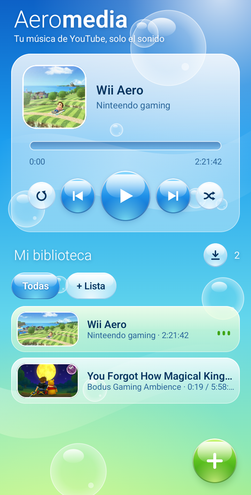
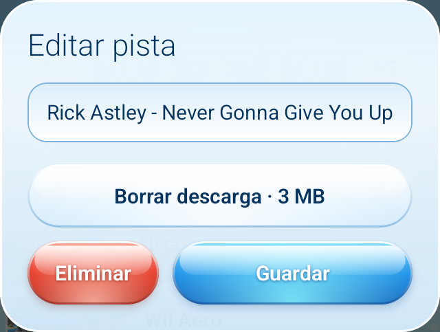
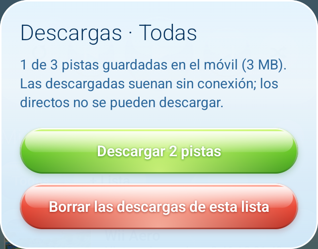

<div align="center">

# Aero**media**

**Tu música de YouTube, solo el sonido.**

Una app de Android que guarda enlaces de YouTube y reproduce únicamente su audio,
con una estética *Frutiger Aero*: cielo, burbujas, cristal y botones brillantes.



</div>

---

## Qué es

Aeromedia nació para llevar al móvil lo que el plugin **skylofi** hace en el escritorio:
guardar enlaces de YouTube y escucharlos sin vídeo. La app lleva **yt-dlp dentro**, así que
no necesita ni el ordenador ni ningún servidor: el propio teléfono resuelve cada enlace
y reproduce el audio en segundo plano.

## Qué puede hacer

| | |
|---|---|
| **Guardar enlaces** | Pega un enlace con el botón verde `+`, o en YouTube pulsa **Compartir → Aeromedia**. Valen vídeos, Shorts y directos. |
| **Solo audio** | Se descarga y se decodifica únicamente el sonido. Sigue sonando con la pantalla apagada y se controla desde la notificación. |
| **Playlists** | Crea tus propias listas y mete o saca pistas de ellas. Al reproducir desde una lista, la cola es solo esa lista. |
| **Importar de YouTube** | Comparte o pega el enlace de una playlist y se guarda entera como lista (hasta 300 vídeos). Más tarde puede traer lo nuevo. |
| **Descargas** | Guarda el audio en el móvil, pista a pista o una lista completa, para oírlo sin conexión. |
| **Directos** | Las emisiones en directo se reproducen marcadas como `EN DIRECTO`. |
| **Controles** | Anterior, siguiente, repetir (lista o pista), aleatorio y barra para saltar dentro de la pista. |

## Cómo se usa

**Añadir música**

- Botón verde `+` → **Pegar** → **Añadir**. El nombre es opcional; si no lo pones se usa el título del vídeo.
- Desde la app de YouTube: **Compartir → Aeromedia**. No hace falta copiar nada.
- Si pegas el enlace de una playlist, se importa como lista.

**Reproducir**

- Toca una pista. Cada pista empieza siempre desde el principio.
- Toca la pista que está sonando para pausarla o reanudarla.

**Listas**

- La fila de cápsulas bajo *Mi biblioteca* muestra **Todas**, tus listas y **+ Lista**.
- Mantén pulsada una pista para renombrarla, meterla en listas, descargarla o eliminarla.
- Mantén pulsado el nombre de una lista para renombrarla o eliminarla.

**Descargas**

- Una pista: mantenla pulsada → **Descargar para oír sin conexión**.
- Una lista entera: el botón redondo con la flecha, junto al contador.
- Las pistas descargadas llevan una flecha verde y suenan sin red.

<div align="center">

&nbsp;&nbsp;

</div>

## Instalar

**Lo más fácil:** descarga el APK de la última versión en
[Releases](../../releases/latest) y ábrelo en un móvil Android 8.0 o superior
(64 o 32 bits ARM). Android te pedirá permiso para instalar apps de origen desconocido.

**Compilarla tú:** hace falta el móvil con la depuración USB activada.

```bash
./gradlew :app:assembleRelease
adb install -r app/build/outputs/apk/release/app-release.apk
```

Para compilar necesitas JDK 17 o superior y el SDK de Android (plataforma 35 y
build-tools 35.0.0). La ruta del SDK va en `local.properties`:

```properties
sdk.dir=/ruta/a/Android/Sdk
```

> [!NOTE]
> El APK ocupa unos 42 MB porque incluye Python y yt-dlp. Si compilas tú, el APK se
> firma con tu clave de depuración; los APK publicados en *Releases* van firmados con
> la clave del proyecto, así que no se pueden instalar uno encima del otro sin
> desinstalar antes.

La primera vez que se abre, la app actualiza yt-dlp; tarda unos segundos y después
lo comprueba sola cada 12 horas.

## Cómo funciona

```
 Enlace de YouTube
        │
        ▼
 ┌──────────────┐   id del vídeo    ┌──────────────────────┐
 │  Biblioteca  │ ────────────────▶ │  yt-dlp en el móvil  │
 │ (JSON local) │                   │ (Python empaquetado) │
 └──────────────┘                   └──────────┬───────────┘
        │                                      │ URL del audio
        │ ¿descargada?                         ▼
        │   sí → archivo local      ┌──────────────────────┐
        └─────────────────────────▶ │  ExoPlayer (Media3)  │ ──▶ 🔊
                                    │ servicio 2.º plano   │
                                    └──────────────────────┘
```

- **Resolución perezosa.** La cola del reproductor contiene marcadores
  `radiotube://v/<id>`. Cuando ExoPlayer va a abrir uno, se llama a yt-dlp y se
  sustituye por la URL real del audio. Así siguiente, anterior y el avance
  automático funcionan sin resolver toda la lista de antemano.
- **Rápido en móviles modestos.** Se usa primero el cliente `visionos` de YouTube,
  que entrega el audio sin el reto de JavaScript: unos 4–5 s por pista. Los clientes
  por defecto de yt-dlp, que en un móvil de gama baja tardan unos 40 s, quedan como
  respaldo.
- **Arranque de Python en caché.** yt-dlp se ejecuta descomprimido para que Python
  guarde su *bytecode*: el arranque baja de 4 s a 1,2 s.
- **Descargas sin conversión.** El audio se guarda tal como lo sirve YouTube (webm
  u m4a), porque no hay ffmpeg en el móvil y ExoPlayer reproduce ambos.

### El código

| Archivo | Qué contiene |
|---|---|
| `Library.kt` | Pistas y listas, guardadas en un JSON; reconocimiento de enlaces. |
| `Yt.kt` | Todo lo que toca yt-dlp: resolver audio, importar playlists, descargar, actualizarse. |
| `PlaybackService.kt` | Reproducción en segundo plano con Media3 y sesión multimedia. |
| `Downloads.kt` | Cola de descargas, progreso y cancelación. |
| `Aero.kt` | El kit visual: fondo, burbujas, cristal, orbes, barra y diálogos. Todo dibujado por código. |
| `MainActivity.kt` | La pantalla, los diálogos y el puente con el reproductor. |

## Limitaciones conocidas

- **Depende de YouTube.** Si YouTube cambia algo, puede dejar de funcionar hasta que
  yt-dlp se actualice (la app lo intenta sola cuando una pista falla).
- **Las descargas viven dentro de la app.** No aparecen en la carpeta Música ni en
  otros reproductores.
- **Una descarga se pierde si Android cierra la app** en segundo plano; con algo
  sonando no ocurre. Para listas largas conviene dejar la app abierta.
- **Sin reordenar.** Las pistas quedan en el orden en que se añadieron.
- **Ahorro de batería.** En algunos móviles (Xiaomi, por ejemplo) hay que poner la
  app en «Sin restricciones» para que no corte la música con la pantalla apagada.

## Créditos

- [yt-dlp](https://github.com/yt-dlp/yt-dlp) — la extracción del audio.
- [youtubedl-android](https://github.com/yausername/youtubedl-android) — Python y yt-dlp empaquetados para Android.
- [AndroidX Media3](https://developer.android.com/media/media3) — reproducción y sesión multimedia.
- [Jetpack Compose](https://developer.android.com/compose) y [Coil](https://coil-kt.github.io/coil/) — la interfaz y las carátulas.
- **skylofi** — el plugin de escritorio que inspiró la idea.

## Licencia

Aeromedia es software libre bajo la [GNU General Public License v3.0](LICENSE): puedes
usarla, estudiarla, modificarla y redistribuirla, siempre que las versiones derivadas
sigan siendo GPL-3.0 y publiquen su código.

La elección viene de sus dependencias: la app incluye
[youtubedl-android](https://github.com/yausername/youtubedl-android), que es GPL-3.0.
El resto son compatibles con ella: Media3, Compose y Coil usan Apache-2.0, y yt-dlp
The Unlicense.

> [!IMPORTANT]
> Aeromedia es un proyecto personal. Úsala con contenido que tengas derecho a
> escuchar y respeta las condiciones de uso de YouTube.
